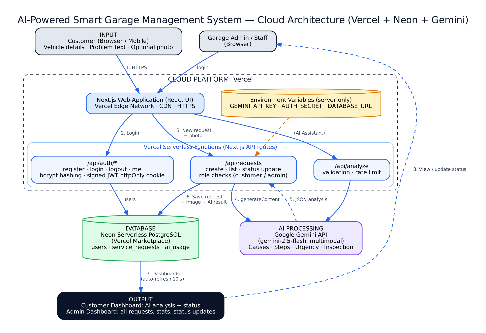

# AI-Powered Smart Garage Management System (Next.js · Vercel)

Cloud Computing CAT-03 individual case study, Dayananda Sagar University.
**Student:** Yeshwanth N · **USN:** ENG24CS0552 · **Section:** I

Customers describe vehicle problems and get **Google Gemini** AI troubleshooting. Garage staff manage every request from a live admin dashboard. Built with **Next.js** and deployed on **Vercel**, using **Firebase** for authentication and the database.



## Technology stack
| Layer | Technology |
|---|---|
| Frontend | Next.js 16 (App Router), React 19, JavaScript, CSS |
| Hosting | Vercel (edge network, HTTPS, auto-deploy from GitHub) |
| Backend / AI proxy | Next.js Route Handler `POST /api/analyze` running as a Vercel Serverless Function |
| AI | Google Gemini API (`gemini-2.5-flash`, multimodal, JSON schema output) |
| Authentication | Firebase Authentication (Email/Password) |
| Database | Cloud Firestore (real-time listeners) |
| Images | Firestore `requestImages` (free plan, default) or Cloud Storage (optional) |
| Secrets | Vercel environment variable `GEMINI_API_KEY` (server only) |

## Features
- **Customer** (`/dashboard`): submit vehicle details, problem and optional photo; view the AI analysis; track status live with notes from the garage.
- **AI Assistant** (`/ai-assistant`): possible causes with likelihood, safe steps, urgency, safety warning, inspection advice and disclaimer. A result can be turned into a booking without a second AI call.
- **Admin** (`/admin`): live table of all requests, 6 stat cards, status distribution, completion rate, search and filters, details view, and status updates.
- **Security:**
  - The Gemini key never reaches the browser.
  - `/api/analyze` verifies Firebase ID tokens using Google's public keys (no service account needed).
  - Input is validated and calls are rate-limited.
  - Firestore Security Rules enforce customer and admin roles.
  - React escapes all output, and security headers are set.

## Project structure
```
smart-garage-nextjs/
├── app/
│   ├── layout.js · globals.css · page.js (home) · not-found.js
│   ├── login/ · register/ · dashboard/ · ai-assistant/ · admin/   (page.js each)
│   └── api/analyze/route.js        ← secure Gemini endpoint (serverless)
├── components/
│   ├── views/ LoginView · RegisterView · CustomerView · AssistantView · AdminView
│   └── Navbar · DashboardShell · AnalysisView · RequestDetails · VehicleFields · Modal · Badges · ...
├── lib/
│   ├── firebase.js (client SDK, lazy init) · auth-context.js · toast-context.js
│   ├── ai-client.js · requests.js · utils.js
│   └── server/ gemini.js · verify-token.js · validate.js · rate-limit.js · errors.js
├── test/validate.test.mjs           ← npm test
├── firestore.rules · storage.rules  ← paste into Firebase Console
├── diagrams/ · documentation/ (report .docx + .pdf) · sample-data/
├── .env.example · next.config.mjs · package.json · jsconfig.json
├── DEMO_GUIDE.md · PRESENTATION.md
```

## Quick start (Windows)
```powershell
cd C:\Projects\smart-garage-nextjs
copy .env.example .env.local     # fill in Firebase config + GEMINI_API_KEY
npm install
npm run dev                      # http://localhost:3000
```
To deploy, push to GitHub, import the repository at vercel.com/new, add the same environment variables, and click **Deploy**. Full steps are in **[DEMO_GUIDE.md](DEMO_GUIDE.md)**.

## Verification status
- ✅ `npm run build` succeeds with Next.js 16.4 (also without any environment variables, so a Vercel build cannot fail because of missing Firebase config).
- ✅ `npm test`: 10 unit tests pass (validation, JSON parsing, rate limit, Gemini request/response handling with a mocked API).
- ✅ The `/api/analyze` route was run with `next start`. It returns 401 for missing or invalid tokens.
- ✅ All UI flows were exercised in headless Chrome with a **mocked** Firebase SDK and a mocked AI response: register, auth guard, submit with photo, AI Assistant hand-off, admin role redirect, status update, search and mobile layout.
- ⚠️ **Not yet tested against a real Firebase project or the real Gemini API, and not deployed to Vercel.** That requires your own keys. Follow DEMO_GUIDE.md section 8.

## Disclaimer
AI suggestions are preliminary and do not replace a professional diagnosis by a qualified mechanic.
# smart-garage-nextjs
